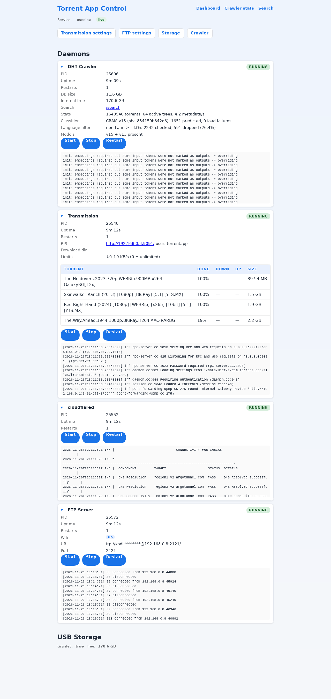

# Torrent App

An Android app that turns a phone into a self-contained torrent box: a DHT crawler that indexes
millions of torrents, a transmission daemon that downloads them, an FTP server that serves the
result to media players, and a web dashboard that controls all of it — with every byte stored on a
USB drive through Android's Storage Access Framework.



<sub>Live dashboard on a phone that has crawled 1.64 M torrents: the DHT crawler card with its
classifier and language-filter lines, transmission with its torrent list, the cloudflared tunnel,
the FTP server and USB storage.</sub>

## What it does

| Capability | What it does |
|---|---|
| **Crawl** | [dht_crawler](https://github.com/wbpxre150/dht_crawler) walks the BitTorrent DHT, fetches metadata and stores names, files and categories in SQLite, with a full-text index over torrent names and file paths. |
| **Classify** | Two on-device models label every row at ingest: a CRAM linear model for **category / TV-kind / adult** (one forward pass, three fields) and a llama.cpp movie-genre classifier. Both are downloaded and sha256-verified on first run, never bundled in the APK. |
| **Download** | A forked transmission 4.1.4 daemon, with torrents added straight from crawler search results. |
| **Serve** | A hand-written C11 FTP server for Kodi, VLC and friends. |
| **Store** | All disk I/O goes through SAF to a USB drive — exFAT-friendly filename transliteration included, so real-world torrents save instead of failing with `I/O error (5)`. |
| **Control** | A Ktor dashboard on `:8090` plus a small Compose screen on the phone for the USB grant, the dashboard URL/QR and shutdown. Optional cloudflared tunnel for access from outside the LAN. |
| **Protect** | Crawler DB backup/restore to S3-compatible storage (R2), plus WAL-safe checkpointing. |

The app is a foreground service that supervises the four native daemons, restarting them with
backoff and shutting them down gracefully.

## Requirements

- Android 8.0 (API 26) or newer, `arm64-v8a`
- A USB drive the phone can mount (used for downloads and the FTP root)
- Several GB of internal storage for the crawler database (it grows with the index — 11.6 GB at 1.6 M torrents on ours) plus ~500 MB for the models

## Build and install

The build needs **JDK 21** — the system JDK 26 is not supported by Android Gradle Plugin 8.8.2.

```bash
export JAVA_HOME=/usr/lib/jvm/java-21-openjdk
export ANDROID_HOME="$HOME/Android/Sdk"
export ANDROID_NDK_HOME="$HOME/Android/Sdk/ndk/android-ndk-r27"
./gradlew installDebug
```

The first build cross-compiles four native binaries (transmission, dht_crawler, the FTP server and
cloudflared) and takes a while; later builds reuse them.

The APK is ~55 MB. The classifier weights (~490 MB) are **not** in it — the crawler downloads them
on first start.

## First run

1. Launch the app and tap **Grant USB** to pick the drive's folder. Everything is written there.
2. Work through the setup wizard: transmission credentials and limits, the FTP user and port, the
   crawler settings, and optionally a database download/restore.
3. The main screen shows a dashboard URL and a QR code — **that URL contains the control token**, so
   treat the screen (and any screenshot of it) as a secret.
4. Open the URL from any browser on the same network. The dashboard has per-daemon start/stop/
   restart, live stats, log tails, settings pages, search, and maintenance actions.

### Ports

| Port | Service | Notes |
|---:|---|---|
| 8090 | Control dashboard | Token-authenticated; LAN and/or tunnel |
| 9091 | transmission RPC | Basic auth; reachable on the LAN by default |
| 8081 | Crawler HTTP API | Loopback only, reached through the app's authenticated proxy |
| 2121 | FTP | Wizard-configurable |

## Project layout

```
app/src/main/java/com/torrent/app/   Kotlin: service hub, dashboard, SAF layer, wizard
app/src/main/cpp/                    Native sources: crawler, transmission fork, FTP, wrapper
app/src/test/                        JVM unit tests (no instrumentation tests)
docs/screenshots/                    Images used above
plan/                                Design and measurement records
tools/                               Host smoke tests, DB rebuild/push, /stats probes
```

## Development

```bash
./gradlew :app:testDebugUnitTest     # ~1,350 unit tests, no device needed
```

Architecture, the 14 invariants that must not be broken, native build wiring and gotchas are in
[`AGENTS.md`](AGENTS.md). Benchmark and gate results are in
[`plan/measured-evidence.md`](plan/measured-evidence.md).

## License

MIT — see [LICENSE](LICENSE).
